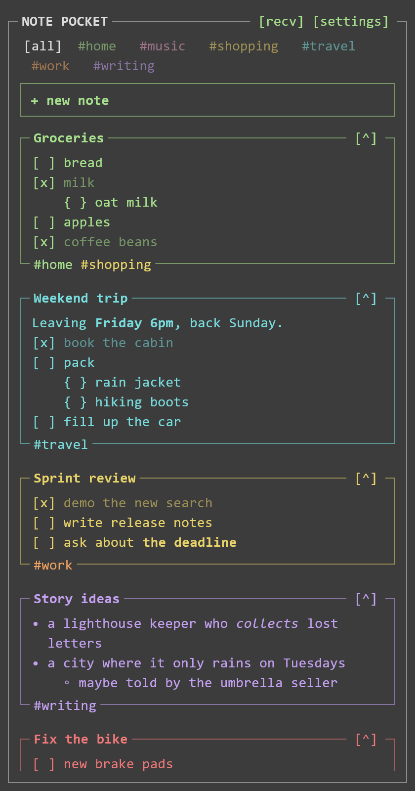
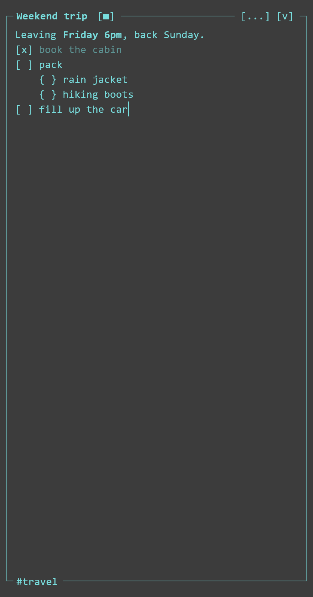

# Note Pocket

A small and basic note keeping app for Windows, Linux and Android.
Each note is a .txt file and uses Markdown to make it compatible with as many other apps as possible.

 

## Download

[Download from GitHub](https://github.com/KabisCube/Note-Pocket/releases)


## Notes formating

```
**Groceries** @green
- [ ] bread
- [x] milk
	- [ ] oat milk
- **ask** about *coffee*
#home #shopping
```

- **First line:** the title, always bold, with an optional color: `@green` `@yellow` `@orange` `@red` `@pink` `@purple` `@blue` `@cyan`
- `- [ ] ` and `- [x] ` are checkboxes, `- ` is a bullet, tabs nest them. Typing `[] ` or `[ ] ` makes a checkbox.
- `**text**` is bold, `*text*` is italic, as in Markdown
- **Last line:** tags like `#home`. Typing `#home@green` in the tags field applies the green color to the tag; `@green` is then removed from the tag and the color is kept locally by the app, not in the note.

The app keeps its own order and settings outside the notes folder, so the notes stay clean.

## Keyboard

| Key | In the note list | In a note |
| --- | --- | --- |
| Up / Down | move between [recv] [settings], tabs, new note and notes | move the cursor; past the first or last line, go to the title or tags |
| Left / Right | switch tag tab, or between [recv] and [settings] | move the cursor; Right at the end of the title goes to the buttons beside it |
| Enter | open the focused note | new line, continues lists; on a button, open its menu |
| Esc | | close the menu or the note |
| Shift+F10 or Menu key | | open the [...] menu |
| Ctrl+Enter or Ctrl+L | | check or uncheck the checkboxes on the selected lines |
| Tab / Shift+Tab | | indent / outdent |
| Ctrl+Up / Ctrl+Down | | move lines up / down |

## Syncing notes

Note Pocket supports sending notes between devices over local wifi.
If notes conflict, you'll get a simplified conflict handler to select lines to keep and what to reject.

Some VPNs block local network discovery. Allow local network sharing, or turn the VPN off while sending.


## Building

Needs [Flutter](https://docs.flutter.dev/get-started/install) 3.50.

```sh
flutter test
flutter run -d windows   # or linux, or an Android device
```

On Windows, `run_windows.bat` and `run_android.bat` do the same. `run_android.bat` uses a JDK and Android SDK in `.tools/` if they are there.

Release signing and publishing are described in [tools/README.md](tools/README.md).

## License

Note Pocket is free software: you can redistribute it and/or modify it under the terms of the GNU General Public License as published by the Free Software Foundation, either version 3 of the License, or (at your option) any later version.

Note Pocket is distributed in the hope that it will be useful, but WITHOUT ANY WARRANTY; without even the implied warranty of MERCHANTABILITY or FITNESS FOR A PARTICULAR PURPOSE. See the [LICENSE](LICENSE) file for details.

Built with [Flutter](https://flutter.dev/) (BSD-3-Clause).
